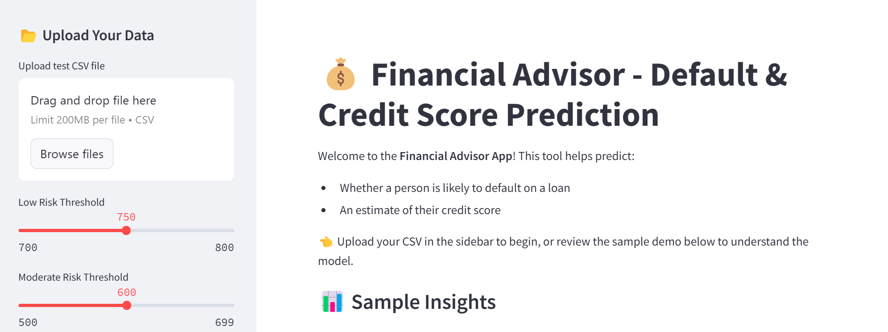
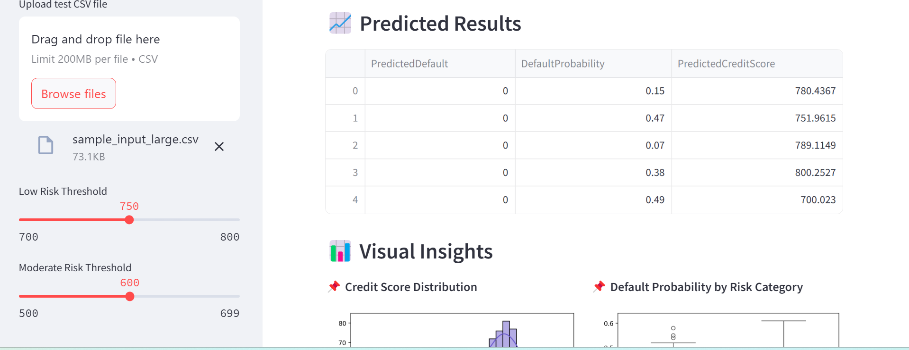
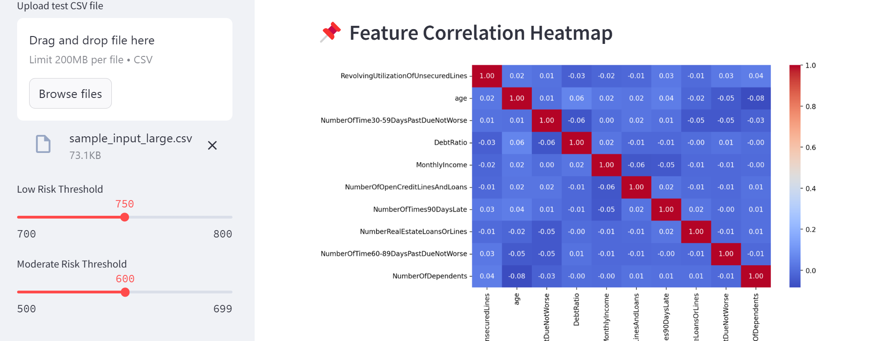
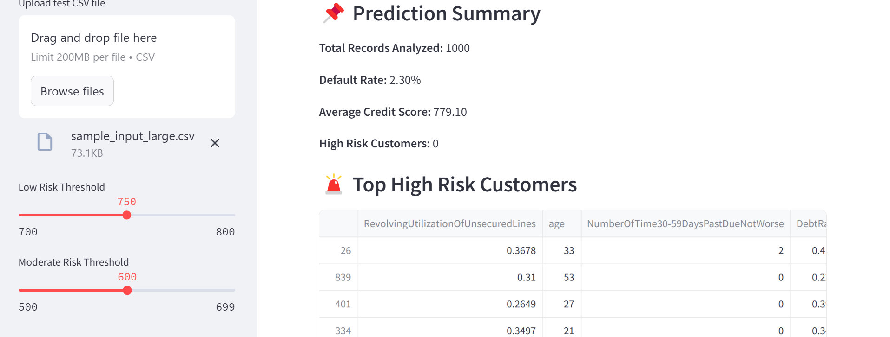

# 💰 Financial Loan Default Predictor


An end-to-end **machine learning + Streamlit** web app that takes a CSV of borrower records and returns, for each person:

- the **likelihood of defaulting** on a loan (prediction + probability), and
- an **estimated credit score** (300–850 scale), bucketed into **🟢 Low / 🟡 Moderate / 🔴 High** risk.

Built on the Kaggle [*Give Me Some Credit*](https://www.kaggle.com/c/GiveMeSomeCredit) dataset as a B.Tech final-year project at UIET, MDU Rohtak (2025). The full write-up is in [`27603ProjectFile.pdf`](27603ProjectFile.pdf).

---

## 📸 Preview

| Upload & risk thresholds | Predicted results |
|:---:|:---:|
|  |  |
| **Feature correlation heatmap** | **Prediction summary** |
|  |  |

---

## 🚀 Features

- **Loan default prediction**: binary prediction plus default probability for every row
- **Credit score estimation**: regression model producing a score on a 300–850 scale
- **Adjustable risk buckets**: sidebar sliders for the Low (default 750) and Moderate (default 600) cut-offs
- **Automatic preprocessing**: median imputation for missing values and removal of invalid rows
- **Visual analytics**: score histogram, default probability by risk category, score vs. probability scatter, default/no-default pie chart, top-10 feature chart and correlation heatmap
- **Summary stats**: records analysed, default rate, average score, high-risk count, and a top-5 highest-risk table
- **Downloadable results**: export predictions as CSV
- **Built-in demo**: sample income and age distributions shown before any file is uploaded

---

## 🛠 Tech Stack

| Area | Tools |
|---|---|
| Language | Python |
| Data & ML | pandas, NumPy, scikit-learn, joblib |
| Visualisation | matplotlib, seaborn |
| Web UI | Streamlit |
| Experimentation | Jupyter Notebook |
| Model hosting | Google Drive (fetched with `gdown`) |

---

## 📁 Project Structure

```
.
├── app.py                          # Streamlit web app
├── download_models.py              # Downloads the trained .pkl models from Google Drive
├── Financial_Default_predictor.ipynb  # EDA, model training and evaluation
├── Financial_Default_predictor.py     # Same notebook exported as a script
├── final_financial_advice.csv      # Batch predictions on data/cs-test.csv
├── 27603ProjectFile.pdf            # Project report
├── data/
│   ├── cs-training.csv             # Kaggle training set (150,000 rows)
│   ├── cs-test.csv                 # Kaggle test set (101,503 rows, no labels)
│   ├── sample_input.csv            # 50-row demo file (also used for the app's sample charts)
│   ├── sample_input_large.csv      # 1,000-row demo file for uploading to the app
│   ├── sampleEntry.csv             # Kaggle submission format example
│   └── Data Dictionary.xls         # Column descriptions
├── outputs/                        # App screenshots (UI_*.png) and notebook plots
├── requirements.txt
├── environment.yml
└── LICENSE
```

---

## ⚙️ Getting Started

### 1. Clone the repository

```bash
git clone https://github.com/dalalaadi30/Financial_Loan_Default_Predictor.git
cd Financial_Loan_Default_Predictor
```

### 2. Install dependencies

```bash
pip install streamlit pandas numpy scikit-learn==1.6.1 joblib matplotlib seaborn gdown
```

> The models were pickled with **scikit-learn 1.6.1**. Using the same version avoids unpickling warnings or errors.
>
> `requirements.txt` and `environment.yml` are full environment exports from the author's Windows machine (they contain local paths and do not include Streamlit or gdown), so the command above is the simplest way to get a working setup on any OS.

### 3. Download the trained models

The model files are not stored in the repo. Fetch them from Google Drive:

```bash
python download_models.py
```

This saves `default_classifier.pkl` and `score_model.pkl` into a `models/` folder. **`app.py` loads them from the project root**, so copy them there:

```bash
# macOS / Linux
cp models/*.pkl .

# Windows (cmd)
copy models\*.pkl .
```

### 4. Run the app

```bash
streamlit run app.py
```

Then open the local URL Streamlit prints (usually <http://localhost:8501>), upload a CSV from the sidebar, and explore the results. To try it quickly, use [`data/sample_input_large.csv`](data/sample_input_large.csv).

---

## 📥 Input Format

Upload a CSV with these **10 columns**, in this order, using these exact names (see [`data/sample_input.csv`](data/sample_input.csv)):

| Column | Description |
|---|---|
| `RevolvingUtilizationOfUnsecuredLines` | Balance on credit cards and personal credit lines divided by total credit limits |
| `age` | Age of the borrower in years |
| `NumberOfTime30-59DaysPastDueNotWorse` | Times 30–59 days past due in the last 2 years |
| `DebtRatio` | Monthly debt payments divided by monthly gross income |
| `MonthlyIncome` | Monthly income |
| `NumberOfOpenCreditLinesAndLoans` | Number of open loans and credit lines |
| `NumberOfTimes90DaysLate` | Times 90+ days late |
| `NumberRealEstateLoansOrLines` | Number of mortgage and real-estate loans |
| `NumberOfTime60-89DaysPastDueNotWorse` | Times 60–89 days past due in the last 2 years |
| `NumberOfDependents` | Number of dependents (excluding the borrower) |

Notes:

- An index column named `Unnamed: 0` is dropped automatically.
- **Do not include the `SeriousDlqin2yrs` target column.** The Kaggle `cs-test.csv` contains an empty one, so remove it before uploading that file.
- Missing values are filled with the column median, and rows with `age <= 0` or `RevolvingUtilizationOfUnsecuredLines > 2` are dropped.

### Output

For each row the app computes:

| Output | Meaning |
|---|---|
| `PredictedDefault` | `1` = likely to default, `0` = not |
| `DefaultProbability` | Model probability of default (0–1) |
| `PredictedCreditScore` | Estimated credit score (300–850) |
| `RiskCategory` | **Low** (score ≥ low threshold), **Moderate** (≥ moderate threshold), otherwise **High** |

---

## 🧠 Models & Methodology

**Data.** 150,000 labelled borrowers from *Give Me Some Credit*, with about 6.7% defaults (10,026 of 150,000). `MonthlyIncome` has 29,731 missing values and `NumberOfDependents` has 3,924.

**Deployed models.** According to the project report, the app uses a **Logistic Regression** classifier for default prediction and a **Linear Regression** model for credit score estimation, both serialised with `joblib`.

**Credit score target.** The dataset has no real credit scores, so the score model is trained on a synthetic target built from the data:

```
score = 850
      - 100 × RevolvingUtilizationOfUnsecuredLines
      -  20 × NumberOfTime30-59DaysPastDueNotWorse
      -  25 × NumberOfTime60-89DaysPastDueNotWorse
      -  30 × NumberOfTimes90DaysLate
      -  50 × DebtRatio
```

clipped to the range 300–850.

**Notebook experiments.** [`Financial_Default_predictor.ipynb`](Financial_Default_predictor.ipynb) walks through EDA and trains **Random Forest** models (with `RandomizedSearchCV` for the regressor) on a train/test split:

| Task | Model | Hold-out result |
|---|---|---|
| Default classification (70/30 split) | Random Forest | ROC AUC **0.84**, accuracy **0.94** |
| Credit score regression (80/20 split) | Tuned Random Forest | R² **0.9997**, RMSE **3.32** |

---

## ⚠️ Limitations

- **The credit score is synthetic**, not a real FICO or bureau score. The regression R² is near-perfect because the target is a direct formula of the input features, so it says little about real-world accuracy.
- **Class imbalance.** In the notebook's Random Forest run, recall for the default class is only 0.19 (precision 0.55), so accuracy alone overstates how well defaults are caught. Treat the default probability as a ranking signal rather than a final decision.
- **Downloaded CSV has no ID column.** It contains only the four output columns, and rows removed by the validity filter are dropped, so it cannot be joined back to the input by position when rows were filtered out.
- **Educational project.** It is not intended for real lending or credit decisions.

---

## 🔮 Future Improvements

- Handle class imbalance (class weights, SMOTE, threshold tuning) and report precision/recall alongside accuracy
- Add an ID column and the original inputs to the exported results
- Load models from `models/` directly and pin dependencies in a clean `requirements.txt`
- Add per-borrower explanations (e.g. SHAP) and deploy on Streamlit Community Cloud

---

## 📄 License

Released under the [MIT License](LICENSE).

## 👤 Author

**Aaditya Dalal**: [@dalalaadi30](https://github.com/dalalaadi30)
B.Tech Computer Science & Engineering, UIET, Maharshi Dayanand University, Rohtak

## 🙏 Acknowledgements

- [Kaggle: Give Me Some Credit](https://www.kaggle.com/c/GiveMeSomeCredit) for the dataset
- Faculty and mentors at UIET, MDU Rohtak
